<div align=center>
  <h1>
  Denoising Diffusion Implicit Models (DDIM) and LoRA
  </h1>
  <p>
    <b>NYCU: Image and Video Generation (2026 Fall)</b><br>
    Programming Assignment 2
  </p>
</div>

<div align=center>
  <p>
    Instructor: <b>Yu-Lun Liu</b> &nbsp;|&nbsp; TA: <b>Jing-En Huang</b>
  </p>
</div>

<div align=center>
  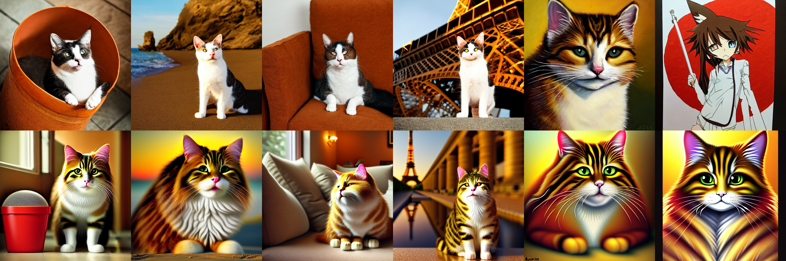
  <p><i>DreamBooth + LoRA on 4 photos of one cat — top: base SD v1.4, bottom: with the LoRA (same prompt and seed per column)</i></p>
</div>

---

## 📘 Overview

Two practical limitations of diffusion models, addressed one at a time.

**Task 1 — DDIM.** DDPM needs all 1000 reverse steps because each one is a Markov transition. DDIM
keeps the DDPM training objective, so the **Lab 1 checkpoint is reused as is**, but samples on a
short sub-sequence of timesteps with a tunable stochasticity η. Checked first on the 2D Swiss Roll
(Task 1-1), then swept over step count × η on AFHQ 64×64 with FID (Task 1-2).

**Task 2 — LoRA.** Fine-tuning Stable Diffusion v1.4 with rank-4 adapters on the UNet attention
layers: once to learn a **style** (Naruto, Task 2-1), and once with **DreamBooth** to learn a
specific **identity** from four photos (Task 2-2).

Full write-up: **[`report/main.pdf`](./report/main.pdf)**.

---

## 🎯 Task 1-1 — DDIM on the Swiss Roll

<table>
<tr>
<td width="50%">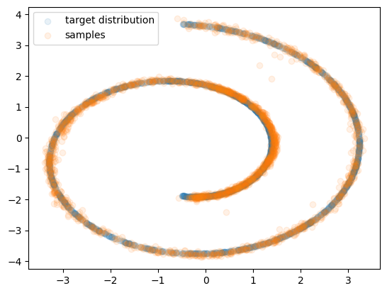</td>
<td width="50%">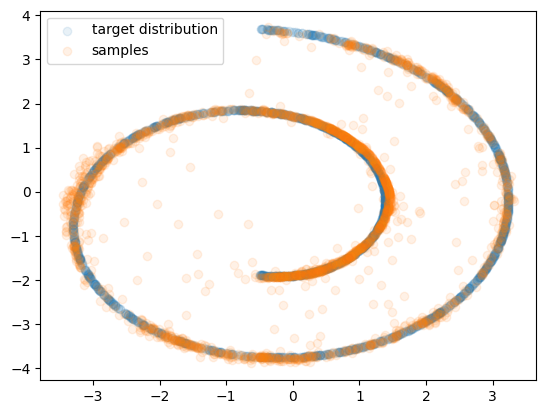</td>
</tr>
<tr>
<td align="center"><i>DDPM, 1000 steps — Chamfer distance 9.41</i></td>
<td align="center"><i>DDIM, 50 steps, η = 0 — Chamfer distance <b>39.78</b> (target &lt; 40)</i></td>
</tr>
</table>

Both samplers recover the spiral with both arms separated and no mode collapse, from the same network
trained for 5000 iterations. The difference is in the outliers: DDIM leaves more points in the empty
space between the arms, which is what raises the Chamfer distance.

That is the expected price of 20× fewer network evaluations. DDPM takes 1000 small steps and injects
fresh noise at each, so an error at one step is partly washed out later. Deterministic DDIM takes 50
jumps of 20 timesteps and commits fully to the current x̂₀ each time — a point pushed the wrong way
early has no mechanism to return to the manifold.

---

## 🎯 Task 1-2 — DDIM for image generation

Lab 1's best checkpoint (linear schedule, noise predictor, DDPM FID 8.29), sampled with every
combination of steps S and η — 20 runs of 500 images each.

| FID ↓ (η \ S) | 10 | 20 | 50 | 100 | 1000 |
|---|---|---|---|---|---|
| 0.0 | 34.18 | 21.30 | 13.04 | 9.29 | 24.55 |
| 0.2 | 27.80 | 21.87 | 11.07 | 8.32 | 15.37 |
| 0.5 | **25.53** | **14.61** | **10.67** | **7.58** | 8.11 |
| 1.0 | 41.94 | 25.37 | 11.84 | 11.54 | **7.20** |

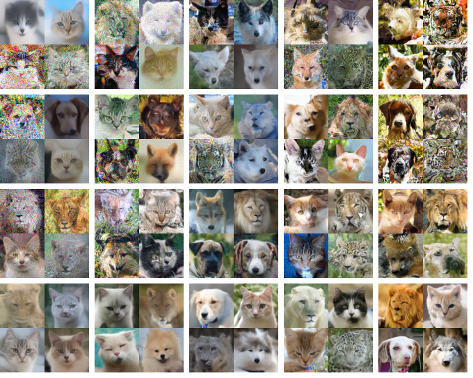

*Same layout as the table: rows η = 0, 0.2, 0.5, 1.0; columns S = 10, 20, 50, 100, 1000.*

**10× less compute, no loss in quality.** S = 100 with η = 0.5 reaches FID **7.58**, better than the
full 1000-step DDPM sampler (8.29) on the same checkpoint. S = 50 already gives ≈ 11 at a twentieth
of the cost.

**More steps help, up to a point.** Every row improves sharply from S = 10 to S = 100. With 10 steps
each jump spans 100 timesteps, and the sampler commits to an x̂₀ that is still close to a dataset
average — the first column is blurry and low-contrast.

**η = 1, S = 1000 is DDPM.** Mathematically this configuration is the DDPM sampler; its 7.20 against
Lab 1's 8.29 is within the run-to-run variance of a 500-sample FID, which mostly confirms the DDIM
step is correct.

**Deterministic DDIM degrades at S = 1000 (24.55).** A deterministic sampler follows one trajectory
and cannot correct an error once made, so small errors from the imperfect ε_θ accumulate over 1000
steps into high-frequency texture and colour noise (top-right of the grid). Injected noise acts as a
corrector, which is why at S = 1000 FID improves monotonically with η.

**Difference from the paper.** The DDIM paper finds η = 0 best at small S; here a moderate η = 0.5
wins for every S ≤ 100. A likely reason is that this is a modest UNet trained for 100k iterations —
its noise prediction is less accurate, so a little error-correcting noise outweighs the
discretization advantage of the deterministic path.

---

## 🎯 Task 2-1 — LoRA on a style (Naruto)

Dataset: [`lambdalabs/naruto-blip-captions`](https://huggingface.co/datasets/lambdalabs/naruto-blip-captions)
— 1,221 Naruto character screenshots with BLIP captions. The captions describe content
(*"a man with dark hair and brown eyes"*) but never the style, so the LoRA has to learn the style as a
property of the images rather than of a trigger word.

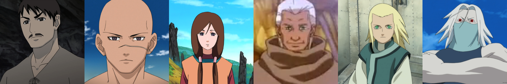

### Results

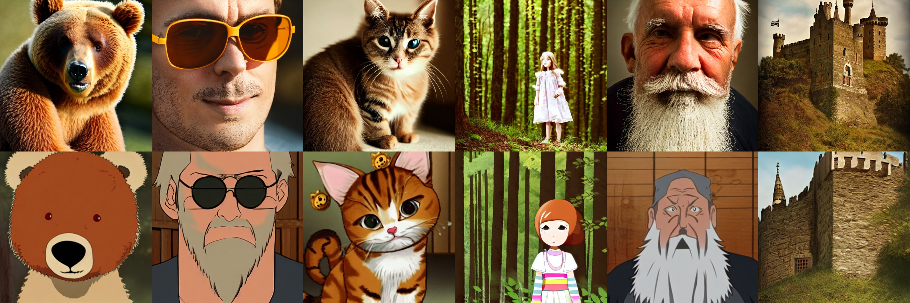

*Top: base SD v1.4. Bottom: + Naruto LoRA. Prompts, left to right: a cute bear · a man with
sunglasses · a cute cat · a girl in a forest · an old man with a white beard · a castle on a hill
(seed 10, 30 steps, CFG 7.5).*

None of the prompts mention Naruto or anime, yet every LoRA image switches to flat cel shading, dark
outlines and anime eyes while keeping the prompt's content and the base model's composition. The
transfer is strongest on **characters**, still clear on **animals** (rarely seen in training, so the
style is learned as a rendering style rather than tied to faces), and weakest on **scenery** — the
dataset contains almost no buildings without a character.

### Training progress

| Epoch 1 | Epoch 5 | Epoch 10 | Epoch 15 |
|---|---|---|---|
| 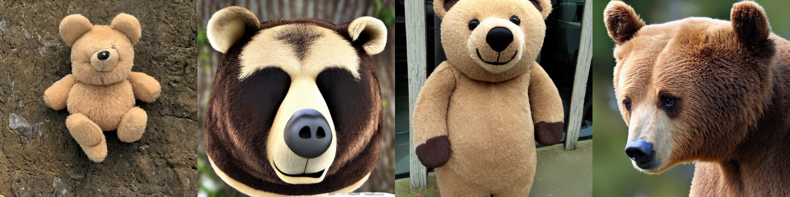 | 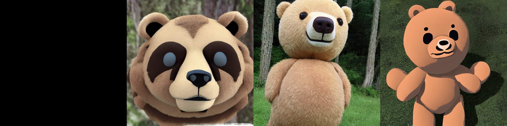 | 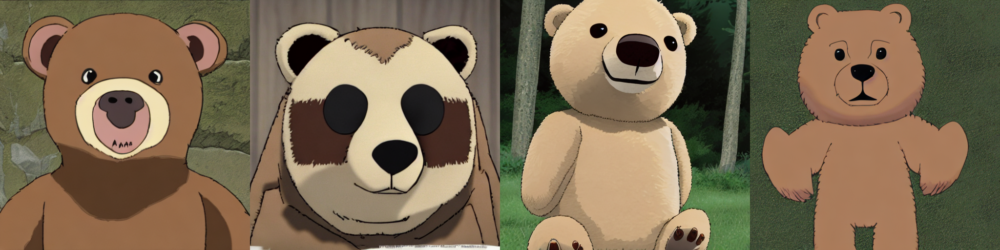 | 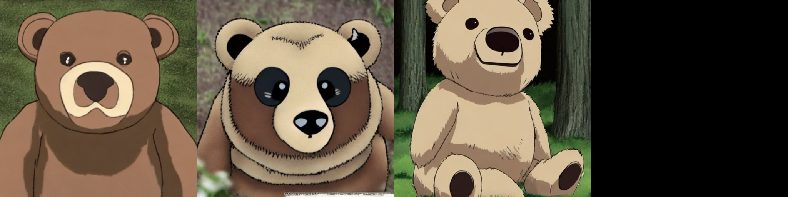 |

*Validation prompt "a cute bear".* Photographic after one epoch, smooth plush-like 3D renders by
epoch 5, and the flat anime look from epoch 10 on. The black squares are false positives of Stable
Diffusion's safety checker, not training failures.

---

## 🎯 Task 2-2 — DreamBooth + LoRA on an identity

Four photos of one long-haired ginger cat (the provided `sample_data/dreambooth-cat`), bound to the
identifier **`sks`** with the instance prompt *"a photo of sks cat"*.

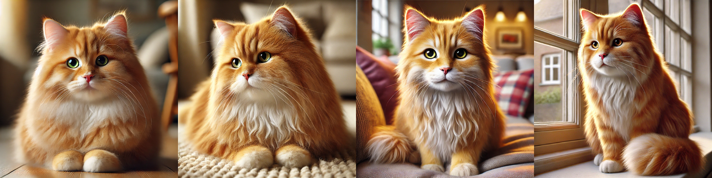

The generated results are the hero image at the top. *Prompts, left to right: a photo of sks cat in
a bucket · on the beach · sleeping on a sofa · in front of the Eiffel Tower · an oil painting of sks
cat · an anime drawing of sks cat (seed 10, 30 steps, CFG 7.5).*

**The identity is learned.** For the base model `sks` is meaningless — a generic black-and-white cat,
and for the anime prompt even a girl with cat ears. With the LoRA every image shows the same fluffy
ginger cat with a white chest and green eyes, consistent across six very different prompts.

**The context is followed.** The beach, the sofa (eyes closed, as asked), the Eiffel Tower and the
painterly oil rendering are all scenes that never appear in the four training photos.

**Typical overfitting on four images.** All outputs inherit the warm palette of the training photos;
the cat sits *next to* the bucket rather than in it; and the anime prompt looks like the oil painting
(language drift). Prior-preservation loss, fewer steps or more varied photos would reduce these — prior
preservation was not enabled in this run.

---

## 📂 Code structure

Files marked ✎ are the ones implemented or configured for this assignment; the rest is provided
scaffolding.

```
.
├── task1                                (Task 1: DDIM)
│   ├── 2d_plot_diffusion_todo           (Task 1-1: Swiss Roll)
│   │   ├── network.py                ✎  # SimpleNet, carried over from Lab 1
│   │   ├── ddpm.py                   ✎  # Lab 1 DDPM + ddim_p_sample, ddim_p_sample_loop
│   │   └── ddpm_tutorial.ipynb          # Training & evaluation notebook
│   └── image_diffusion_todo             (Task 1-2: Image generation)
│       ├── scheduler.py              ✎  # Lab 1 DDPM scheduler + DDIMScheduler
│       ├── model.py                  ✎  # Lab 1 losses, carried over
│       ├── sampling.py                  # DDPM / DDIM sampling script
│       ├── train.py                     # Training script
│       └── fid/                         # FID evaluation tools
└── task2                                (Task 2: LoRA)
    ├── scripts
    │   ├── train_lora.sh             ✎  # Task 2-1: style LoRA (Naruto)
    │   ├── train_lora_custom.sh         # Style LoRA on a custom folder (unused)
    │   └── train_dreambooth_lora.sh  ✎  # Task 2-2: DreamBooth + LoRA
    ├── lora_inference.ipynb          ✎  # Before/after comparison grids
    ├── train_lora.py                    # Provided LoRA training code
    ├── train_dreambooth_lora.py         # Provided DreamBooth + LoRA training code
    └── 112550011_task2-{1,2}_lora_weight.txt   # Links to the trained LoRA weights
```

### What was implemented

**Task 1-1** — `ddim_p_sample` as one DDIM step: predict ε, form x̂₀, and move to the previous
timestep of the sub-sequence along the deterministic direction plus σ_t-scaled noise;
`ddim_p_sample_loop` as the loop over an evenly spaced sub-sequence of the 1000 training timesteps.

**Task 1-2** — `DDIMScheduler.set_inference_timesteps` (the strided sub-sequence) and
`DDIMScheduler.step` (the same update in image space, with η controlling σ_t, so η = 1 with all 1000
steps reduces exactly to DDPM).

**Task 2** — no LoRA code to write; the work is configuration. Both scripts switch to fp16 mixed
precision; the style LoRA is trained for 15 epochs instead of 100 (the style is fully learned by
then), and the DreamBooth instance prompt is changed to *"a photo of sks cat"* so that `sks` directly
modifies "cat".

---

## ⚙️ Reproducing

### Environment

```bash
conda create -n lab2-ddim-lora python=3.9 -y
conda activate lab2-ddim-lora
pip install -r requirements.txt
```

### Task 1-1

```bash
cd task1/2d_plot_diffusion_todo
jupyter lab ddpm_tutorial.ipynb
```

The notebook trains a fresh Swiss Roll model for 5000 iterations and evaluates DDPM and DDIM on it.
Each sampling call draws new noise, so the DDIM Chamfer distance varies from run to run around the
40 threshold.

### Task 1-2

From `task1/image_diffusion_todo/`, with a Lab 1 checkpoint trained with `--predictor noise`:

```bash
python dataset.py                 # once, prepares the AFHQ eval set
python sampling.py --ckpt_path {CKPT} --save_dir samples/ddim_s{S}_eta{ETA} \
    --sample_method ddim --ddim_steps {S} --eta {ETA}
python fid/measure_fid.py data/afhq/eval samples/ddim_s{S}_eta{ETA}
```

Repeat for S ∈ {10, 20, 50, 100, 1000} and η ∈ {0.0, 0.2, 0.5, 1.0}, one directory per pair.

### Task 2

Authenticate with Hugging Face first, then from `task2/`:

```bash
sh scripts/train_lora.sh               # Task 2-1, Naruto style
sh scripts/train_dreambooth_lora.sh    # Task 2-2, sks cat
```

Generate the comparison grids with `lora_inference.ipynb`, pointing its configuration cell at the
trained weights. The trained weights are linked in `task2/112550011_task2-{1,2}_lora_weight.txt`.
