<div align=center>
  <h1>
  Score Distillation: SDS, VSD and SDI
  </h1>
  <p>
    <b>NYCU: Image and Video Generation (2026 Fall)</b><br>
    Programming Assignment 3
  </p>
</div>

<div align=center>
  <p>
    Instructor: <b>Yu-Lun Liu</b> &nbsp;|&nbsp; TA: <b>Li-Zhong Szu-Tu</b>
  </p>
</div>

<div align=center>
  <table>
  <tr>
    <td align="center"><b>SDS</b></td>
    <td>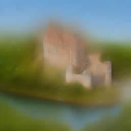</td>
    <td></td>
    <td>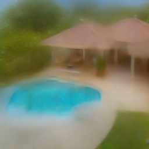</td>
    <td>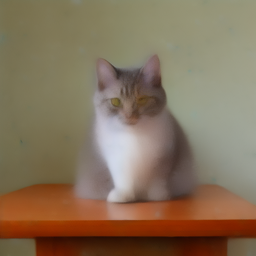</td>
  </tr>
  <tr>
    <td align="center"><b>VSD</b></td>
    <td></td>
    <td>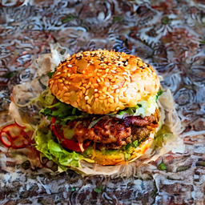</td>
    <td>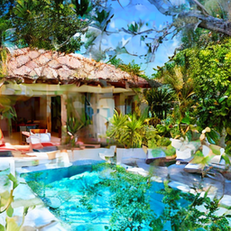</td>
    <td>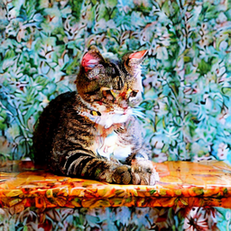</td>
  </tr>
  <tr>
    <td align="center"><b>SDI</b></td>
    <td></td>
    <td></td>
    <td></td>
    <td>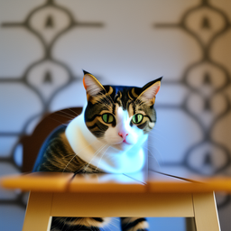</td>
  </tr>
  </table>
  <p><i>Stable Diffusion 2.1-base used as a critic to optimize a single latent — no reverse sampling</i></p>
</div>

---

## 📘 Overview

Ordinary diffusion sampling runs the reverse process from pure noise. **Score distillation** instead
treats the image — here a 1×4×64×64 Stable Diffusion latent — as free parameters, and uses a frozen
diffusion model only as a critic: at each iteration it looks at a noisy copy of the current latent
and says which way to move to better match the prompt. This turns a diffusion model into a loss
function, which is what makes text-to-3D methods like DreamFusion possible.

Three methods are implemented for text-to-image on the 10 evaluation prompts, scored by CLIP
ViT-B/32 image–text similarity:

- **SDS** — Score Distillation Sampling (DreamFusion)
- **VSD** — Variational Score Distillation (ProlificDreamer)
- **SDI** — Score Distillation via Inversion, with a hand-written DDIM inversion

Full write-up: **[`report/main.pdf`](./report/main.pdf)**.

---

## 🎯 Results

| Method | CLIP ↑ | Visual impression |
|---|---|---|
| **SDS** | **0.3071** | right content, but blurry and washed out |
| VSD | 0.2982 | sharp and detailed, but over-saturated with mosaic-like textures |
| SDI | 0.3010 | cleanest — sharp objects, natural colours |

All three clear the 0.28 threshold for full marks. SDS has the highest average, but the gap is small
and the ranking changes per prompt (VSD wins cabin / church / castle, SDI wins the villa). CLIP
ViT-B/32 mostly checks that the object is present and is not very sensitive to blur, so a clean but
blurry SDS object scores well while VSD's busy textures cost points — the score does not fully
match how sharp the images look.

<table>
<tr><td><b>SDS</b></td>
<td>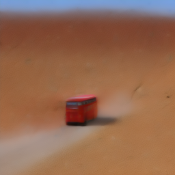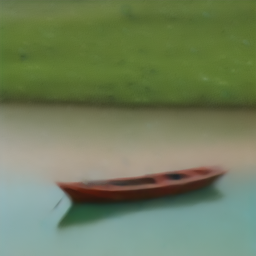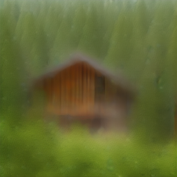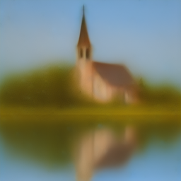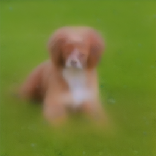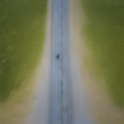</td></tr>
<tr><td><b>VSD</b></td>
<td>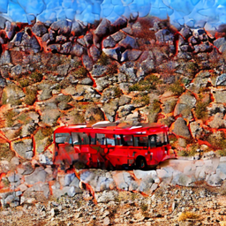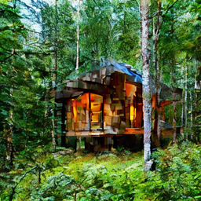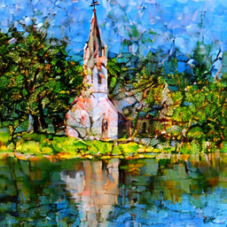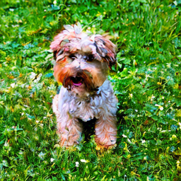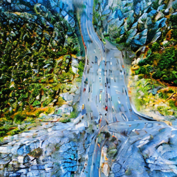</td></tr>
<tr><td><b>SDI</b></td>
<td>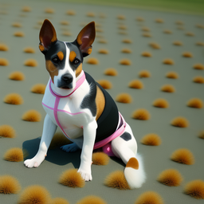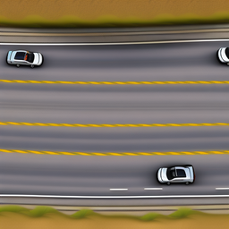</td></tr>
</table>

*Left to right: red bus · boat · cabin · church · villa · castle · burger · dog · cat · car.*

**Why VSD and SDI look better than SDS.** SDS compares the model's noise prediction against a *fresh
random* ε at every step, so successive updates point in slightly different directions and average out
into a smooth, blurry image; it needs a very large guidance scale (25) just to keep enough signal.
VSD and SDI both replace that random ε with something consistent with the current image — a LoRA
trained online on the current latents (VSD), or the noise recovered by DDIM inversion (SDI) — which
gives a cleaner, more stable signal and works at the usual guidance of 7.5.

---

## 🔬 Ablations

Each ablation changes one hyperparameter, runs all 10 prompts, and reports the average CLIP score.

### SDS — `guidance_scale`

| 7.5 | 15 | 25 | 50 | 100 |
|---|---|---|---|---|
| 0.2547 | 0.2837 | 0.3071 | **0.3076** | 0.3015 |

At 7.5–15 the images are blurry blobs, sometimes without the object at all; 25–50 is the sweet spot;
at 100 colours become too strong and noisy textures appear. SDS needs far more guidance than the 7.5
of ordinary sampling because the random noise makes the averaged signal weak.

### SDI — `inversion_n_steps`

| | 1 | 3 | 5 | 10 | 25 |
|---|---|---|---|---|---|
| CLIP | 0.2030 | 0.3020 | 0.3018 | 0.3010 | **0.3054** |
| Time / prompt | 13 s | 21 s | 26 s | 44 s | 93 s |

A single inversion step fails completely: one DDIM jump from 0 to t is too inaccurate, so the
recovered noise does not match the image. From 3 steps on the inversion is good enough; beyond that
quality improves only slightly while runtime grows linearly.

### SDI — `sdi_update_interval`

| | 25 | 75 | 200 | 500 | 1000 |
|---|---|---|---|---|---|
| CLIP | **0.3010** | 0.2963 | 0.2960 | 0.2942 | 0.2226 |
| Time / prompt | 44 s | 17 s | 8 s | 6 s | 5 s |

Refreshing the target less often makes the latent chase a stale target computed for an older image
and timestep. At 1000 the target is computed only once, from a random latent at t ≈ 980, and the
result collapses into a colour blob.

<table>
<tr>
<td width="33%"><b>SDS guidance</b> 7.5 → 100</td>
<td width="33%"><b>SDI inversion steps</b> 1 → 25</td>
<td width="33%"><b>SDI update interval</b> 25 → 1000</td>
</tr>
<tr>
<td>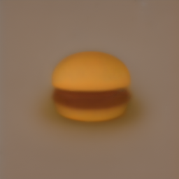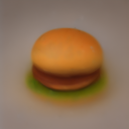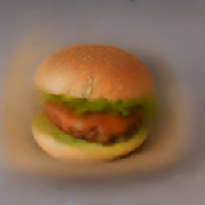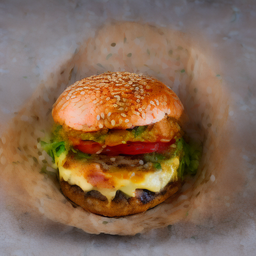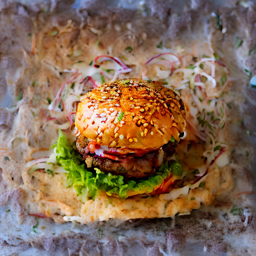</td>
<td>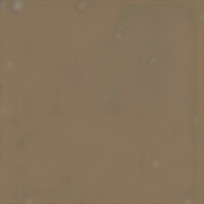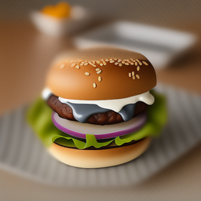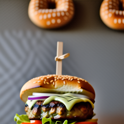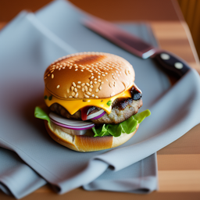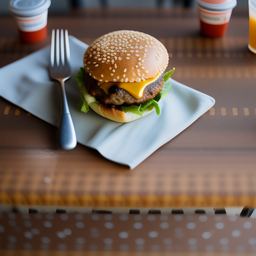</td>
<td>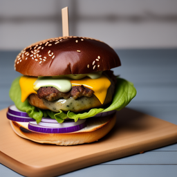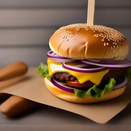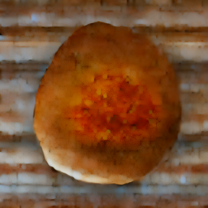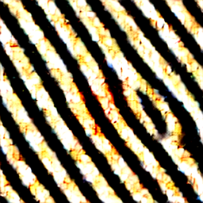</td>
</tr>
</table>

---

## 💡 Why not just minimize the diffusion loss?

<table>
<tr><td><b>‖ε̂ − ε‖²</b></td>
<td>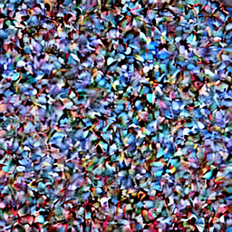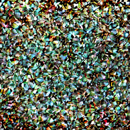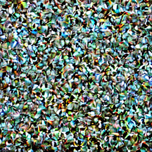</td></tr>
<tr><td><b>SDS</b></td>
<td></td></tr>
</table>

Same setup as SDS, but backpropagating the plain diffusion loss through the UNet
(`scripts/diff_loss.py`). The only difference is one term: the full gradient contains the UNet
Jacobian ∂ε̂/∂x_t, and SDS drops it. With the Jacobian, the optimizer discovers that tiny
high-frequency changes are the fastest way to make the UNet's noise prediction more accurate — much
like an adversarial attack — so the latent turns into colourful noise. Without it, the residual
ε̂ − ε itself points towards a cleaner image of the prompt, which is why SDS works.

---

## 📂 Code structure

Files marked ✎ were implemented or added for this assignment; the rest is provided scaffolding. Only
`guidance/sd.py` is part of the graded submission.

```
.
├── guidance
│   └── sd.py                  ✎  # get_sds_loss, get_vsd_loss, invert_noise, get_sdi_loss
├── main.py                       # Latent optimization loop
├── eval.py / eval.sh             # CLIP evaluation / unified SDS-VSD-SDI runner
├── scripts                       (helpers for experiments and the report)
│   ├── ablation_sds.sh        ✎  # SDS guidance_scale sweep
│   ├── run_vsd.sh             ✎  # VSD main run
│   ├── run_sdi.sh             ✎  # One SDI configuration on all prompts + CLIP
│   ├── ablation_sdi.sh        ✎  # SDI main run + both ablations
│   ├── diff_loss.py           ✎  # Original diffusion loss experiment
│   └── make_report_assets.py  ✎  # Copies results into report/ and fills the CLIP tables
├── report                     ✎  # LaTeX report (CVPR template) and main.pdf
└── template/                     # Report templates provided by the TA
```

### What was implemented

**SDS** — sample t ∈ [20, 980] and ε, noise the latent, predict with CFG under `no_grad`, and form
the gradient w(t)(ε̂ − ε) with w(t) = 1 − ᾱ_t. The gradient is handed to the optimizer as an MSE to
the detached target `latents − grad`, whose derivative is exactly that gradient.

**VSD** — ε_θ from the UNet with the LoRA adapters *disabled* (CFG 7.5), ε_φ from the same UNet with
them *enabled* (conditional only). The distillation term updates only the latent; a standard
denoising loss on a detached copy of the latent updates only the LoRA, and both are stepped together.

**SDI** — `invert_noise` is a hand-written deterministic DDIM inversion (η = 0, as allowed; no library
inversion utilities), walking from 0 to t in n steps with CFG −7.5. `get_sdi_loss` anneals t linearly
from 980 to 20, and every `update_interval` iterations inverts the latent, predicts the noise with
CFG 7.5 and one-step denoises it into a cached target. In between, the loss is just the MSE to that
target, so most iterations need no UNet call.

---

## ⚙️ Reproducing

### Environment

```bash
conda create -n lab3 python=3.11 -y
conda activate lab3
pip install -r requirements.txt
```

Stable Diffusion 2.1-base is downloaded automatically from the community mirror
`sd2-community/stable-diffusion-2-1-base`; no Hugging Face login is needed.

### Main results

The provided runner generates all 10 prompts and evaluates CLIP:

```bash
bash eval.sh --sds
bash eval.sh --vsd --guidance 7.5 --lora-lr 1e-4 --lora-loss-weight 1.0 --lora-rank 4
bash eval.sh --sdi --guidance 7.5 --lr 0.005 --steps 1000 \
             --inversion-n-steps 10 --inversion-guidance-scale -7.5 \
             --inversion-eta 0.3 --sdi-update-interval 25
```

`eval.sh` always writes to `outputs/{sds,vsd,sdi}/`, so a second run overwrites the first. The
scripts in `scripts/` give every configuration its own directory instead:

```bash
bash scripts/ablation_sds.sh 0 7.5 15 25 50 100   # -> outputs/ablation/sds_guidance/gs_<v>/
bash scripts/run_vsd.sh 0                          # -> outputs/vsd/
bash scripts/ablation_sdi.sh 0                     # -> outputs/sdi/ + outputs/ablation/sdi_*/
python scripts/diff_loss.py --device 0             # -> outputs/diff_loss/
python scripts/make_report_assets.py               # -> report/Figure, report/Table
```

The first argument is the GPU index. Approximate time per prompt on an RTX 4090: SDS ~1.5 min,
VSD ~2 min, SDI ~45 s. `main.py` does not set a random seed, so re-running gives slightly different
images and scores.
