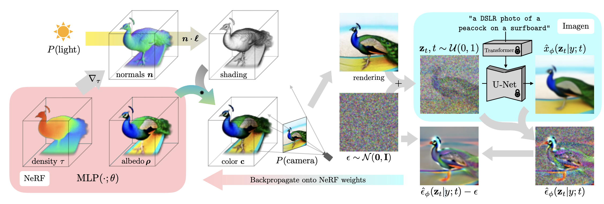
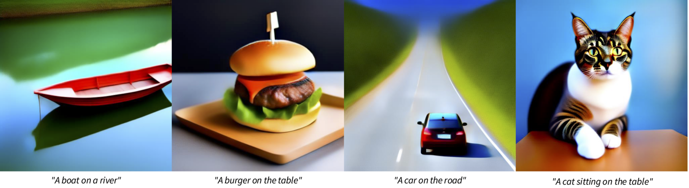
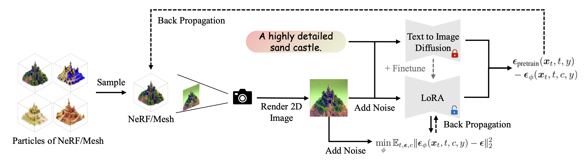
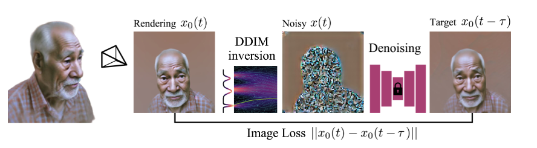
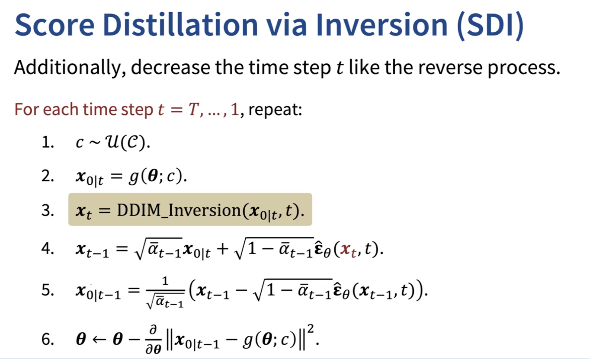

<div align="center">
  <h1>
  Score Distillation Sampling
  </h1>
  <p>
    <b><a href="https://yulunalexliu.github.io/courses/image-video-generation/">NYCU: Image and Video Generation (2026 Fall)</a></b><br>
    <a href="https://youtu.be/9qofXn6GtpY">Video</a>
    |
    <a href="https://github.com/Sytwu/Lab3-Distillation/blob/main/asset/Lab3-Distillation.pdf">Slides</a>
    |
    <a href="https://github.com/Sytwu/Lab3-Distillation">GitHub</a><br>
    Programming Assignment 3
  </p>
</div>

<div align="center">
  <p>
    Instructor: <b>Yu-Lun Liu</b><br>
    TA: <b>Li-Zhong Szu-Tu</b><br>
    Design: <b>Ying-Huan Chen</b><br>
  </p>
</div>

<p align="center">
  
</p>

---

## Description

Score Distillation Sampling (SDS) is a diffusion-based technique that leverages a pretrained model to guide generation by **distilling the score** (how a sample aligns with the target distribution) back into the optimization of a parameterized target (e.g., a latent image).

This assignment focuses on **text-to-image** with three methods:

- **SDS** - Score Distillation Sampling (Task 1)
- **VSD** - Variational Score Distillation (Task 2)
- **SDI** - Score Distillation via Inversion (Task 3)

---

## Setup

```
conda create -n lab3 python=3.11
conda activate lab3
pip install -r requirements.txt
```

The pretrained model is Stable Diffusion 2.1-base. Since the original `stabilityai/stable-diffusion-2-1-base` repository is no longer available, we use the community mirror [`sd2-community/stable-diffusion-2-1-base`](https://huggingface.co/sd2-community/stable-diffusion-2-1-base), which hosts the same weights. It is downloaded automatically on the first run; no Hugging Face login is required.

---

## Code Structure

```
.
├── asset/                    # images for README (teaser, method figs)
│
├── guidance/                 # implement: get_sds_loss, get_vsd_loss,
│   └── sd.py                 # invert_noise, get_sdi_loss
│
├── template/                 # report templates (for reference only)
│   ├── LaTeX/                # main.tex
│   ├── Markdown/             # report.md
│   └── Typst/                # report.typ
│
├── eval.py                   # CLIP evaluation
├── eval.sh                   # unified evaluator (SDS / VSD / SDI)
├── main.py                   # training/optimization entry
├── utils.py                  # helpers (I/O, image save)
│
├── requirements.txt
└── README.md
```

---

## Task 0: Introduction
Distillation sampling parameterizes the target content (e.g., images) and optimizes the parameters using the gradient of the distillation loss function $\nabla_{x^0} L$. In this assignment, we denote $`c`$ as a text prompt, $`\mathbf{x^{t}}`$ as a noisy sample, $`\epsilon`$ as a random sample from a standard Gaussian distribution, and $`\epsilon_\theta(\cdot, \cdot, \cdot)`$ as a pretrained diffusion model that predicts the noise in the input. 


We focus on **text-to-image** (no editing tasks). The evaluation prompts are the default prompts defined in `eval.sh`.  
For each task, implement the loss function in `guidance/sd.py`. 

---

## Task 1 - Score Distillation Sampling (SDS) [20 pts]

<p align="center">

</p>

In this task, you will generate images using SDS. First, initialize a latent $\mathbf{x^{0}} \sim \mathcal{N}(0, I)$ whose resolution matches that of the pretrained diffusion model ($`1 \times 4 \times 64 \times 64`$). Then randomly sample a timestep $t$ and add noise to the latent, which outputs $`\mathbf{x^{t}}`$ (Equation 4 in [DDIM](https://arxiv.org/abs/2010.02502)). Lastly, feed the noisy latent to the pretrained diffusion model $`\epsilon_\theta(\mathbf{x^{t}}, c, t)`$ and compute the SDS loss provided below, which will be used to update the latent $`x^{0}`$. To visualize the sampled latents, use `decode_latents()` in `guidance/sd.py`.

$$
\begin{align*} 
\nabla_{x^{0}} L_{sds}= \mathbb{E}_ {t, \epsilon} \left[ ( \epsilon_\theta(\mathbf{x^{t}}, c, t) - \epsilon ) \right].
\end{align*}
$$

### ✅ TODO
Implement **`get_sds_loss()`** in `guidance/sd.py`.  
Return a scalar SDS loss given latent $x^0$, text embedding $c$, and CFG guidance.

### 💻 Run Command
```
python main.py --prompt "${PROMPT}" --loss_type sds --guidance_scale 25
```

---

## Task 2 - Variational Score Distillation (VSD) [20 pts]

<p align="center">

</p>

Variational Score Distillation (VSD) in ProlificDreamer aims to improve the sampling quality of SDS by utilizing [LoRA](https://arxiv.org/abs/2106.09685) to mimic the noise prediction of a pretrained diffusion model. Given the pretrained diffusion model and a LoRA module, denoted as $\phi$, VSD optimizes the following loss:

$$
\begin{align*} 
\nabla_{x^{0}} L_{vsd}= \mathbb{E}_ {t, \epsilon} \left[ ( \epsilon_\theta(\mathbf{x^{t}}, c, t) - \epsilon_\phi(\mathbf{x^{t}}, c, t) ) \right].
\end{align*}
$$

### ✅ TODO
Implement **`get_vsd_loss()`** in `guidance/sd.py`.  
Generate images using the same text prompts provided in Task 1. For VSD, use 7.5 for the `guidance_scale`.

### 💻 Run Command
```
python main.py --prompt "${PROMPT}" --loss_type vsd --guidance_scale 7.5 \
               --lora_lr 1e-4 --lora_loss_weight 1.0 --lora_rank 4
```

---

## Task 3 - Score Distillation via Inversion (SDI) [30 pts]

<p align="center">
  
</p>

SDI improves SDS stability by performing **DDIM inversion** before computing score differences.

<p align="center">
  
</p>

### ✅ TODO

Implement **`invert_noise()`** and **`get_sdi_loss()`** in `guidance/sd.py`, and **complete all in-function `TODO` items**.  

- Write the DDIM inversion loop in `invert_noise()` yourself. You must **NOT** call any built-in inversion utilities (e.g., `DDIMInverseScheduler`, `invert`, `ddim_invert`, `invert_step`) from diffusers or other libraries.
- You may assume `eta = 0` (deterministic inversion) and ignore `inversion_eta`; no points will be deducted for this.

**Additional Arguments:**
- `inversion_guidance_scale` (default **-7.5**): CFG scale used **during DDIM inversion** (often negative for stable inversion).
- `inversion_n_steps` (default **10**): number of inversion steps from `x₀` to `x_t` (more steps = more accurate, slower).
- `inversion_eta` (default **0.3**): stochasticity of inversion (`0` = deterministic DDIM).
- `sdi_update_interval` (default **25**): refresh the cached `x₀^{target}` every **N** iterations to reduce cost and jitter.


### 💻 Run Command
```
python main.py --prompt "${PROMPT}" --loss_type sdi --lr 0.005 --steps 1000 --guidance_scale 7.5 \
               --inversion_n_steps 10 --inversion_guidance_scale -7.5 \
               --inversion_eta 0.3 --sdi_update_interval 25
```
---

## Evaluation

Use the unified evaluation script `eval.sh`:

```
bash eval.sh --sds
bash eval.sh --vsd --guidance 7.5 --lora-lr 1e-4 --lora-loss-weight 1.0 --lora-rank 4
bash eval.sh --sdi --guidance 7.5 --lr 0.005 --steps 1000 \
             --inversion-n-steps 10 --inversion-guidance-scale -7.5 \
             --inversion-eta 0.3 --sdi-update-interval 25
```

Each command will:
1. Generate results for all default prompts.
2. Run CLIP evaluation automatically and save final results to:
```
./outputs/{loss_type}/
├── <prompt>.png
└── eval.json
```

---

## What to Submit

Submit `{STUDENT_ID}_lab3.zip` containing:
```
./{STUDENT_ID}_lab3.zip/
├── guidance/sd.py
├── outputs/{sds,vsd,sdi}/ + eval.json
└── report.pdf
```

### Report (30 pts)

Report templates in LaTeX, Markdown, and Typst are provided in `template/`. They are for reference only: you are free to use your own format, as long as the report covers all the items below.

1. Introduction \
[2 pts] Briefly describe and summarize the goal of this assignment.
2. Methodology \
[6 pts] Explain SDS, VSD, and SDI, covering both the concepts and your implementation.
3. Experiments & Results \
[6 pts] Provide both quantitative results (CLIP score) and qualitative results (output images). \
[6 pts] Conduct an ablation study on (1) SDS: `guidance_scale`; (2) SDI: `inversion_n_steps`; (3) SDI: `sdi_update_interval`. \
[2 pts] Specify all hyperparameters you used for each task.
4. Discussion \
[3 pts] Intuitively explain why the original loss function ℒ_Diff = ‖ɛ̂θ(xt, y, t) − εt‖^2 does not produce realistic samples in practice. \
[3 pts] Intuitively analyze why SDI and VSD perform better than SDS in your own words (without heavy math).
5. Conclusion \
[2 pts] Wrap up your report with a short summary.

---

## Grading

| Component    | Points  | Description                           |
| ------------ | ------- | ------------------------------------- |
| Task 1 - SDS | 20      | Correct implementation + results      |
| Task 2 - VSD | 20      | Correct implementation + results      |
| Task 3 - SDI | 30      | Correct implementation + results      |
| Report       | 30      | Clear analysis, comparisons, insights |
| **Total**    | **100** |                                       |

### CLIP Score Thresholds
The CLIP score is the average image-text cosine similarity over all prompts, computed with CLIP ViT-B/32 (`eval.py`).

| CLIP Score | SDS (20 pts) | VSD (20 pts) | SDI (30 pts) |
| ---------- | ------------ | ------------ | ------------ |
| ≥ 0.28     | 20 pts       | 20 pts       | 30 pts       |
| 0.26-0.28  | 15 pts       | 15 pts       | 25 pts       |
| 0.24-0.26  | 10 pts       | 10 pts       | 20 pts       |
| < 0.24     | 0            | 0            | 0            |

---

## Rules

- Modify **only** `guidance/sd.py`.
- Plagiarism → automatic zero.

---

## Pat This Cat
If you run into any problems during your implementation, you can pat this cat. It will soothe your soul and bring you good luck!

```
            ／＞　  フ
            | 　_　_| 
          ／` ミ＿xノ 
         /　　　　 |
        /　 ヽ　　 ﾉ
        │　　|　|　|
    ／￣|　　|　|　|
   (￣ヽ＿__ ヽ_)__)
    ＼二)
```

---

## References

[1] Denoising Diffusion Probabilistic Models (https://arxiv.org/abs/2006.11239) \
[2] Denoising Diffusion Implicit Models (https://arxiv.org/abs/2010.02502) \
[3] Null-text Inversion (https://arxiv.org/abs/2211.09794) \
[4] SDEdit: Guided Image Synthesis and Editing with SDE (https://arxiv.org/abs/2108.01073) \
[5] LoRA: Low-Rank Adaptation of Large Language Models (https://arxiv.org/abs/2106.09685) \
[6] DreamFusion: Text-to-3D using 2D Diffusion (https://arxiv.org/abs/2209.14988) \
[7] ProlificDreamer (https://arxiv.org/abs/2305.16213) \
[8] Score Distillation via Reparametrized DDIM (https://arxiv.org/abs/2405.15891) \
[9] KAIST CS492(D): Diffusion Models (https://mhsung.github.io/kaist-cs492d-fall-2024/) \
[10] Previous Lab3 Assignment (by Ying-Huan Chen) (https://github.com/YingHuan-Chen/Lab3-Distillation)

---
