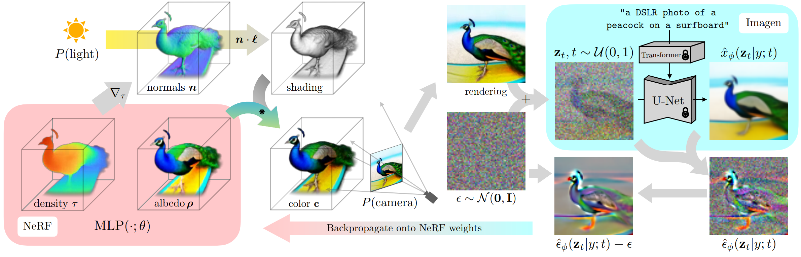

# Lab3: Score Distillation Sampling Implementation

**Your Name (Student ID)** · NYCU · your.email@example.com

<!--
Figures: copy outputs/{sds,vsd,sdi}/ into figures/{sds,vsd,sdi}/.
Ablation images: figures/ablation/<setting>/<value>/<prompt>.png
Quoted (gray) paragraphs are hints: replace them and every 0.0000 before exporting.
Export: VS Code "Markdown PDF" or "Markdown Preview Enhanced" extension, or Typora; the <style> block at the end sets the layout.
-->



**Figure 1.** **Overview of score distillation.**

> Describe it briefly; cite its source if not yours.

## 1. Introduction

<!-- [2 pts] Briefly describe and summarize the goal of this assignment. -->

> What problem does score distillation address, and how is it different from ordinary diffusion sampling? Keep it to a few sentences; you may refer to Figure 1.

> State the goal of this assignment: which methods you implemented, what you generated, and how you evaluated the results.

> (Optional) Briefly outline the rest of the report.

## 2. Methodology

<!-- [6 pts] Explain SDS, VSD, and SDI; both the concept and your implementation. -->

> Introduce the background and notation shared by the three methods (e.g. the pretrained diffusion model [6], the forward noising process [4], classifier-free guidance [9]), so the following subsections can refer to them.

### 2.1 Score Distillation Sampling (SDS)

**Concept.**

> In your own words: what is being optimized in SDS [1], where does the gradient come from, and why is it a reasonable objective? Point out the approximation that makes SDS practical.

**Implementation.**

> Paste your `get_sds_loss()` into the code block below, then walk through it: the main steps, the design choices you made and why, and anything that was tricky to get right.

```python
def get_sds_loss(
    self, latents, text_embeddings,
    guidance_scale=7.5,
):
    # Paste your implementation here
    ...
```

### 2.2 Variational Score Distillation (VSD)

**Concept.**

> Which weakness of SDS does VSD [2] try to fix? What extra component does it introduce (cf. LoRA [7]), and what is that component trained to do?

**Implementation.**

> Paste your `get_vsd_loss()` into the code block below, then walk through it: how the extra component is set up and updated, how its loss and the distillation loss interact, and which parts receive gradients.

```python
def get_vsd_loss(
    self, latents, text_embeddings,
    guidance_scale=7.5, lora_loss_weight=1.0,
):
    # Paste your implementation here
    ...
```

### 2.3 Score Distillation via Inversion (SDI)

**Concept.**

> Which weakness of SDS does SDI [3] try to fix? How does it obtain the noisy sample differently (cf. DDIM [5]), and how does its timestep schedule differ from SDS?

**Implementation.**

> Paste your `invert_noise()` (DDIM inversion) and `get_sdi_loss()` into the two code blocks below, then walk through them: how your inversion loop works, how the timestep changes over the iterations, and how and when the target is updated.

```python
@torch.no_grad()
def invert_noise(
    self, latents, target_t, text_embeddings,
    guidance_scale=-7.5, n_steps=10, eta=0.3,
):
    # Paste your DDIM inversion here
    ...
```

```python
def get_sdi_loss(
    self, latents, text_embeddings,
    guidance_scale=7.5,
    current_iter=0, total_iters=500,
    inversion_guidance_scale=-7.5,
    inversion_n_steps=10, inversion_eta=0.3,
    update_interval=25,
):
    # Paste your implementation here
    ...
```

## 3. Experiments & Results

<!--
[6 pts] Quantitative results (CLIP score) + qualitative results (output images).
[6 pts] Ablation: (1) SDS guidance_scale; (2) SDI inversion_n_steps; (3) SDI sdi_update_interval.
[2 pts] All hyperparameters for each task.
-->

### 3.1 Quantitative Results

<!-- Values: outputs/{sds,vsd,sdi}/eval.json -->

**Table 1.** CLIP score (↑, ViT-B/32) per prompt.

| Prompt | SDS | VSD | SDI |
|:-|:-:|:-:|:-:|
| A red bus driving on a desert road | 0.0000 | 0.0000 | 0.0000 |
| a boat in a river | 0.0000 | 0.0000 | 0.0000 |
| A cabin surrounded by forests | 0.0000 | 0.0000 | 0.0000 |
| A church beside a lake | 0.0000 | 0.0000 | 0.0000 |
| A villa close to the pool | 0.0000 | 0.0000 | 0.0000 |
| A castle next to a river | 0.0000 | 0.0000 | 0.0000 |
| A burger on the table | 0.0000 | 0.0000 | 0.0000 |
| A dog sitting on grass | 0.0000 | 0.0000 | 0.0000 |
| a cat sitting on a table | 0.0000 | 0.0000 | 0.0000 |
| A car on the road | 0.0000 | 0.0000 | 0.0000 |
| **Average** | 0.0000 | 0.0000 | 0.0000 |

> Which method has the best average CLIP score (Table 1)? Are there prompts where the ranking changes, and why might that be? Does the score agree with your visual impression?

### 3.2 Qualitative Results

**Figure 2.** Qualitative comparison of SDS, VSD and SDI on the 10 evaluation prompts.

| | | | | | | | | | | |
|:---|:------:|:------:|:------:|:------:|:------:|:------:|:------:|:------:|:------:|:------:|
| **SDS** |  |  |  |  |  |  |  |  |  |  |
| **VSD** |  |  |  |  |  |  |  |  |  |  |
| **SDI** |  |  |  |  |  |  |  |  |  |  |

> Compare the methods visually and point to concrete examples in Figure 2. What are the typical strengths and failure cases of each method?

### 3.3 Ablation Study

**Table 2.** Ablation study. Average CLIP score (↑).

| Setting | | | | | |
|:-|:-:|:-:|:-:|:-:|:-:|
| *(a) SDS: `guidance_scale`* | 7.5 | 15 | 25 | 50 | 100 |
| CLIP | 0.0000 | 0.0000 | 0.0000 | 0.0000 | 0.0000 |
| *(b) SDI: `inversion_n_steps`* | 1 | 3 | 5 | 10 | 25 |
| CLIP | 0.0000 | 0.0000 | 0.0000 | 0.0000 | 0.0000 |
| *(c) SDI: `sdi_update_interval`* | 25 | 75 | 200 | 500 | 1000 |
| CLIP | 0.0000 | 0.0000 | 0.0000 | 0.0000 | 0.0000 |

> Briefly describe the setup: which prompts and values were tested; all other hyperparameters follow Table 3. Table 2 lists the CLIP scores of all three ablations.

#### SDS: `guidance_scale`

**Figure 3.** Ablation on SDS `guidance_scale`.

| `guidance_scale` | 7.5 | 15 | 25 | 50 | 100 |
|:----------------|:---:|:---:|:---:|:---:|:---:|
| A burger on the table |  |  |  |  |  |
| a cat sitting on a table |  |  |  |  |  |
| A villa close to the pool |  |  |  |  |  |

> How do the results change as the guidance scale increases (Figure 3, Table 2 (a)), and why? Which value works best, and how does it compare with the guidance scale typically used for ordinary sampling?

#### SDI: `inversion_n_steps`

**Figure 4.** Ablation on SDI `inversion_n_steps`.

| `inversion_n_steps` | 1 | 3 | 5 | 10 | 25 |
|:----------------|:---:|:---:|:---:|:---:|:---:|
| A burger on the table |  |  |  |  |  |
| a cat sitting on a table |  |  |  |  |  |
| A villa close to the pool |  |  |  |  |  |

> How do the results and the runtime change with the number of inversion steps (Figure 4, Table 2 (b)), and why? Is there a trade-off?

#### SDI: `sdi_update_interval`

**Figure 5.** Ablation on SDI `sdi_update_interval`.

| `sdi_update_interval` | 25 | 75 | 200 | 500 | 1000 |
|:----------------|:---:|:---:|:---:|:---:|:---:|
| A burger on the table |  |  |  |  |  |
| a cat sitting on a table |  |  |  |  |  |
| A villa close to the pool |  |  |  |  |  |

> How do the results change with the update interval (Figure 5, Table 2 (c)), and why? What happens at the two extremes?

### 3.4 Hyperparameters

**Table 3.** Hyperparameters for each task.

| Hyperparameter | SDS | VSD | SDI |
|:-|:-:|:-:|:-:|
| `guidance_scale` | 25 | 7.5 | 7.5 |
| `lr` | 0.01 | 0.01 | 0.005 |
| `steps` | 500 | 500 | 1000 |
| `lora_lr` | – | 1e-4 | – |
| `lora_rank` | – | 4 | – |
| `lora_loss_weight` | – | 1.0 | – |
| `inversion_n_steps` | – | – | 10 |
| `inversion_guidance_scale` | – | – | -7.5 |
| `inversion_eta` | – | – | 0.3 |
| `sdi_update_interval` | – | – | 25 |

> Fill in Table 3 with the settings you actually used (defaults are pre-filled from `main.py` / README) and justify any value you changed.

## 4. Discussion

### 4.1 Why the Original Diffusion Loss Fails

<!-- [3 pts] Intuitively explain why L_Diff = ||eps_hat(x_t, y, t) - eps_t||^2 did not produce
realistic samples (use < 1 math equation) & provide visual results of applying L_Diff. -->

**Figure 6.** Original diffusion loss (top) vs. SDS (bottom).

| | A dog sitting on grass | A castle next to a river | A car on the road | A church beside a lake |
|:-----------------|:-----:|:-----:|:-----:|:-----:|
| **Diff. loss** |  |  |  |  |
| **SDS** |  |  |  |  |

> Explain how you produced the result in Figure 6. Then explain intuitively (at most one equation) why directly optimizing the diffusion loss does not give realistic images, and connect your explanation to what is visible in the figure.

### 4.2 Why SDI and VSD Outperform SDS

<!-- [3 pts] Intuitively analyze why SDI and VSD perform better than SDS (without heavy math). -->

**SDS.**

> What are the typical artifacts of SDS in your results, and what in the SDS update causes them?

**VSD.**

> What does VSD change compared with SDS, and why does that lead to better results? Explain intuitively, without heavy math, and support it with your own figures or numbers.

**SDI.**

> What does SDI change compared with SDS, and why does that lead to better results? Explain intuitively, without heavy math, and support it with your own figures or numbers.

## 5. Conclusion

<!-- [2 pts] Wrap up all the context in your report and give a short summary. -->

> Summarize what you implemented, the main quantitative and qualitative findings, the key lessons from the ablations, and your answer to why VSD and SDI outperform SDS.

## References

1. B. Poole, A. Jain, J. T. Barron, and B. Mildenhall. DreamFusion: Text-to-3D using 2D Diffusion. *ICLR*, 2023.
2. Z. Wang, C. Lu, Y. Wang, F. Bao, C. Li, H. Su, and J. Zhu. ProlificDreamer: High-Fidelity and Diverse Text-to-3D Generation with Variational Score Distillation. *NeurIPS*, 2023.
3. A. Lukoianov, H. Sáez de Ocáriz Borde, K. Greenewald, V. C. Guizilini, T. Bagautdinov, V. Sitzmann, and J. Solomon. Score Distillation via Reparametrized DDIM. *NeurIPS*, 2024.
4. J. Ho, A. Jain, and P. Abbeel. Denoising Diffusion Probabilistic Models. *NeurIPS*, 2020.
5. J. Song, C. Meng, and S. Ermon. Denoising Diffusion Implicit Models. *ICLR*, 2021.
6. R. Rombach, A. Blattmann, D. Lorenz, P. Esser, and B. Ommer. High-Resolution Image Synthesis with Latent Diffusion Models. *CVPR*, 2022.
7. E. J. Hu, Y. Shen, P. Wallis, Z. Allen-Zhu, Y. Li, S. Wang, L. Wang, and W. Chen. LoRA: Low-Rank Adaptation of Large Language Models. *ICLR*, 2022.
8. A. Radford, J. W. Kim, C. Hallacy, A. Ramesh, G. Goh, S. Agarwal, G. Sastry, A. Askell, P. Mishkin, J. Clark, G. Krueger, and I. Sutskever. Learning Transferable Visual Models From Natural Language Supervision. *ICML*, 2021.
9. J. Ho and T. Salimans. Classifier-Free Diffusion Guidance. *arXiv:2207.12598*, 2022.

<style>
/* PDF styling for Chromium-based export (VS Code "Markdown PDF" / Markdown Preview Enhanced, Typora, browser print). */
@page { size: A4; margin: 15mm; }
body { max-width: 180mm; margin: 0 auto; font: 10pt/1.5 "Helvetica Neue", Arial, "Noto Sans CJK TC", "Microsoft JhengHei", sans-serif; color: #222; }
h1 { font-size: 19pt; text-align: center; margin: 0 0 .3em; border: 0; }
h1 + p { text-align: center; color: #555; }
h2 { font-size: 14pt; margin: 1.4em 0 .5em; padding-bottom: .15em; border-bottom: 1px solid #ccc; }
h3 { font-size: 11.5pt; margin: 1.2em 0 .4em; }
h4 { font-size: 10pt; margin: 1em 0 .3em; }
h2, h3, h4 { break-after: avoid; }
p:has(> img) { text-align: center; }
img { max-width: 100%; }
/* hints (gray quotes): replace them with your own text */
blockquote { margin: .5em 0; padding: 0 .9em; border-left: 3px solid #d0d7de; color: #8b929a; }
blockquote p { margin: .35em 0; }
code { font-family: Menlo, Consolas, "DejaVu Sans Mono", monospace; font-size: .88em; }
pre { padding: .6em .9em; background: #f6f8fa; border: 1px solid #e1e4e8; border-radius: 4px; line-height: 1.4; white-space: pre-wrap; break-inside: avoid; }
/* tables: booktabs-style rules; a caption ("**Table N.** ...") stays with its table */
p:has(+ table) { margin-bottom: .4em; break-after: avoid; }
table { margin: 0 auto 1.2em; border-collapse: collapse; border-top: 1.5px solid #222; border-bottom: 1.5px solid #222; font-size: 9pt; break-inside: avoid; }
thead { border-bottom: 1px solid #222; }
th, td { padding: .2em .8em; }
/* image grids: no rules, fixed image sizes (Fig. 6 images are 1.5x the ablation ones: 2 rows = 3 ablation rows) */
table:has(img) { border: 0; font-size: 8pt; }
table:has(img) thead { border: 0; }
table:has(img) :is(th, td) { padding: 1px 2px; font-weight: normal; }
td img { display: block; width: 16mm; aspect-ratio: 1; background: #eee; }
td img[src*="ablation"] { width: 26mm; }
table:has(img[src*="diff_loss"]) td img { width: 39mm; }
</style>
