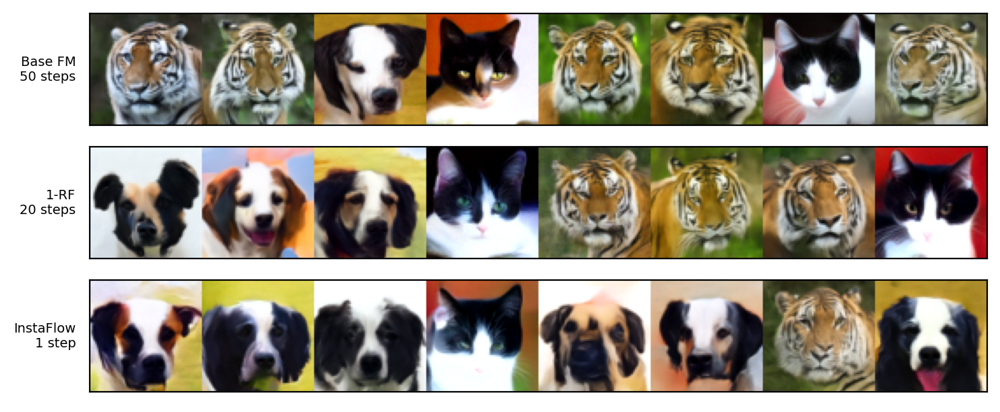
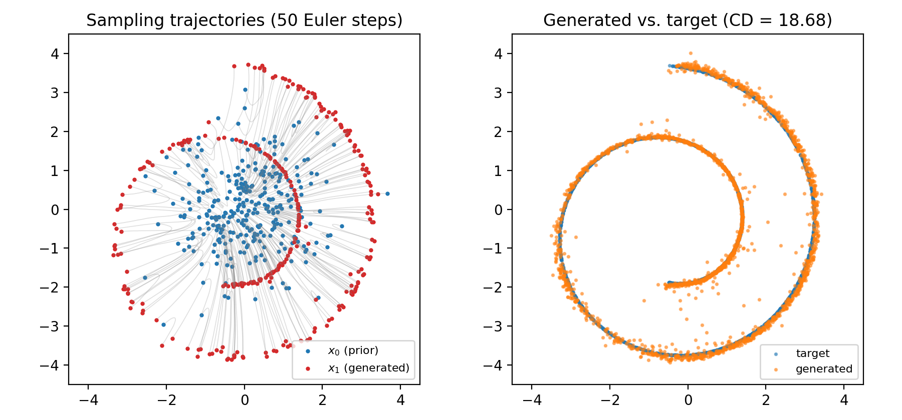
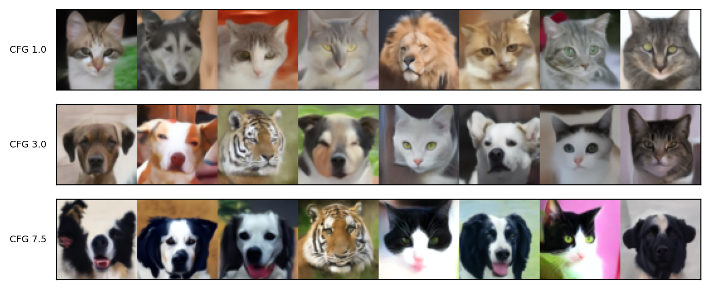
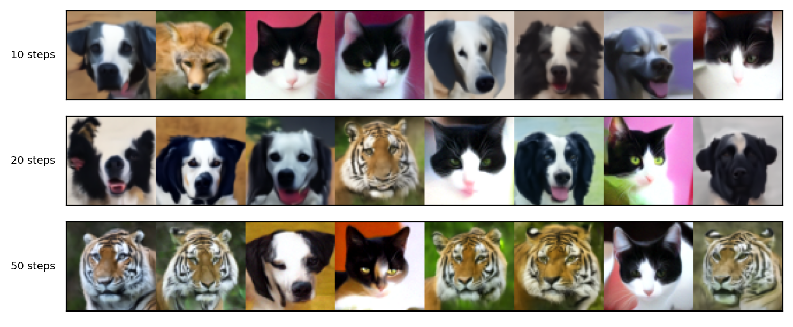
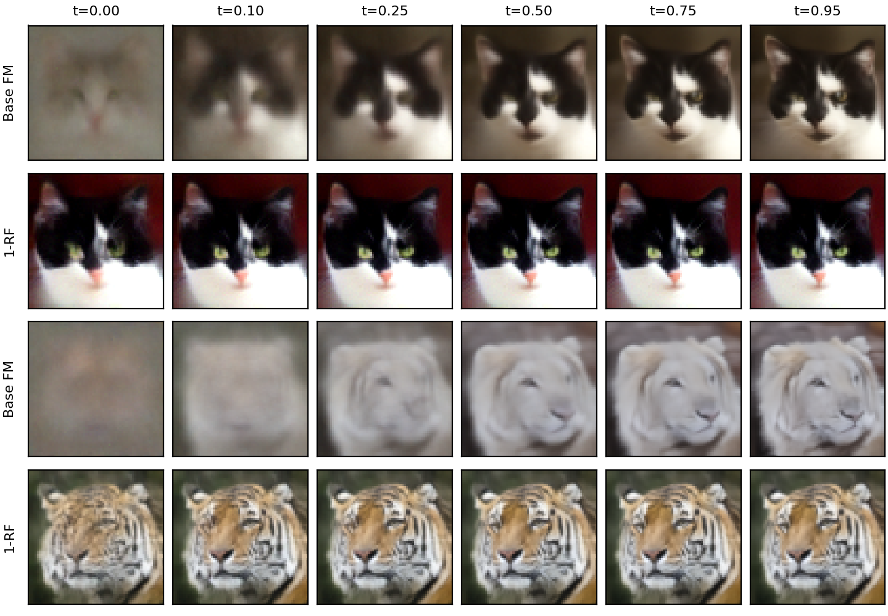
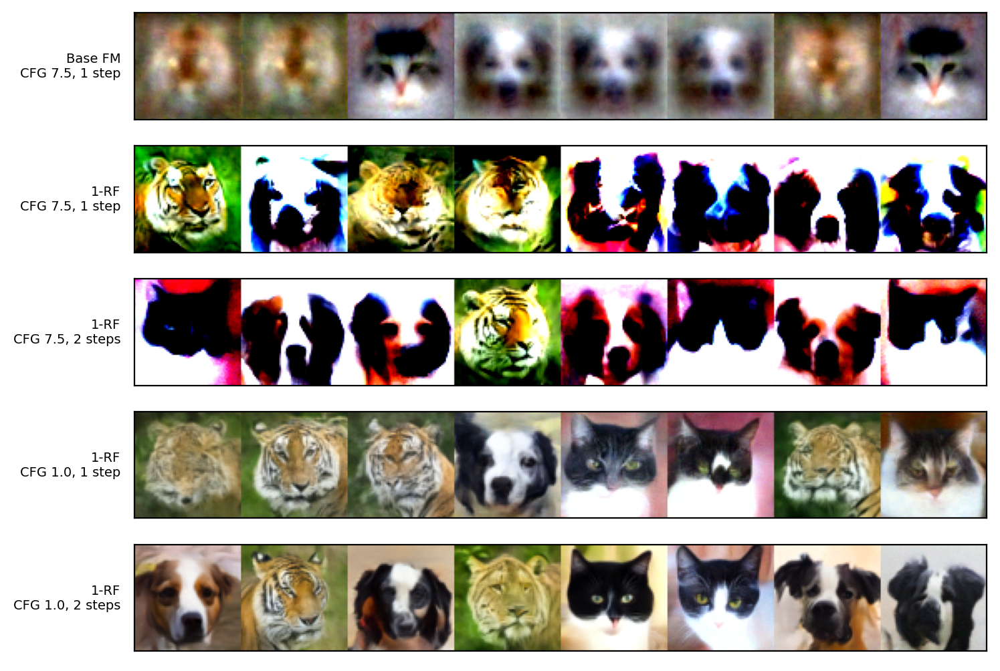
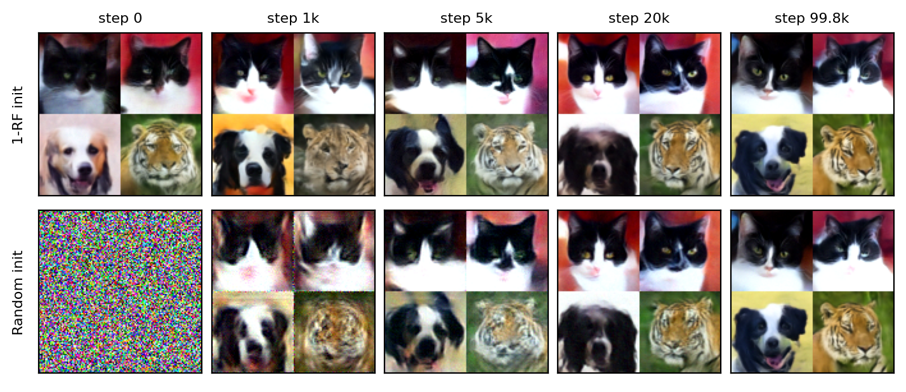

<div align=center>
  <h1>
  Flow Matching, Rectified Flow and InstaFlow
  </h1>
  <p>
    <b>NYCU: Image and Video Generation (2026 Fall)</b><br>
    Programming Assignment 4
  </p>
</div>

<div align=center>
  <p>
    Instructor: <b>Yu-Lun Liu</b> &nbsp;|&nbsp; TA: <b>Po-Fan Yu</b>
  </p>
</div>

<div align=center>
  
  <p><i>AFHQ 64×64, class-conditional. Base FM (100 network evaluations) → 1-Rectified Flow (40) → InstaFlow (1)</i></p>
</div>

---

## 📘 Overview

**Flow Matching** trains a network to predict a velocity field that carries Gaussian noise to data
along straight lines x_t = (1−t)x₀ + t·x₁, and samples by integrating the ODE with Euler steps.
Because noise and data are paired at random, the straight lines cross and the learned field ends up
curved, so many steps are needed. This assignment removes that cost in three stages:

| Task | What | Result |
|---|---|---|
| 1 | Flow Matching on a 2D Swiss roll | Chamfer distance **13.49** |
| 2 | Class-conditional image FM on AFHQ with classifier-free guidance | FID **7.39** (20 steps, CFG 7.5) |
| 3 | **Rectified Flow**: retrain on the model's own (noise, image) pairs | FID **5.52** with only **5 steps** |
| 4 | **InstaFlow** (bonus): distill the rectified flow into a one-step generator | FID **7.38** with **1 step**, **~100× faster** |

All four clear the full-score thresholds (CD < 40, FID < 30). Full write-up:
**[`report/main.pdf`](./report/main.pdf)**.

---

## 🎯 Results

### Task 1 — 2D Flow Matching

<div align=center>
  
</div>

The trajectories are almost straight near the prior and bend near the end, where points have to pick
an arm of the spiral. The figure is from a re-run with the same configuration (CD 18.68); the graded
notebook run reached **13.49**.

### Task 2 — Image FM with classifier-free guidance

| CFG scale (20 steps) | 1.0 | 3.0 | **7.5** |
|---|---|---|---|
| FID | 12.18 | 12.13 | **7.39** |

| Steps (CFG 7.5) | 10 | 20 | 50 |
|---|---|---|---|
| FID | 8.14 | 7.39 | 5.47 |

<table>
<tr><td align="center"><b>CFG 1.0 / 3.0 / 7.5</b></td><td align="center"><b>10 / 20 / 50 steps</b></td></tr>
<tr><td></td><td></td></tr>
</table>

Stronger guidance gives sharper, more class-typical animals (and lower FID) at the cost of diversity.

### Task 3 — Rectified Flow

50k (noise, image) pairs are generated by the Task 2 model, and a new model is trained on exactly
these pairs. ODE trajectories never cross, so the new targets no longer conflict and the field
becomes almost straight.

| Steps (CFG 7.5) | Base FM | **1-RF** | Time / 500 images |
|---|---|---|---|
| 5 | 8.72 | **5.52** | 14 s |
| 10 | 9.16 | **3.35** | 28 s |
| 20 | 5.84 | **3.29** | 57 s |

5 steps of 1-RF match 20 steps of base FM — a **~4× speed-up** at equal quality.

<div align=center>
  
  <p><i>Predicted endpoint x̂₁ = x_t + (1−t)·v_t along one trajectory. Base FM starts from a blurry
  average and decides details gradually; 1-RF already knows the final image at t = 0.</i></p>
</div>

**Straightness** S = E_t ‖(x₁ − x₀) − v_t‖²: without guidance 1-RF is **14× straighter** (0.0016
vs. 0.0222). With CFG 7.5 it looks *less* straight (0.59), but almost all of that is one big jump in
the first step, where CFG multiplies the large gap between conditional and unconditional velocity by
7.5. The reflow targets already contain guidance, so 1-RF works well even without it:

| Steps (CFG 1.0) | 1 | 2 | 5 | 10 | 20 |
|---|---|---|---|---|---|
| Base FM | 94.64 | 80.88 | 36.56 | 17.06 | 11.05 |
| **1-RF** | **17.67** | **10.14** | **8.07** | **7.26** | **6.96** |

<div align=center>
  
  <p><i>1–2 step sampling. With CFG 7.5 the first-step jump saturates most 1-RF images (yet FID still
  reports ~9 — 500-sample FID is unreliable here); without guidance one step already works.</i></p>
</div>

### Task 4 — InstaFlow (bonus)

The 1-RF teacher (20 steps, CFG 1.5) generates 50k pairs, and a student is trained to land on the
teacher's endpoint in one Euler step: ‖x₀ + v(x₀, 0 | c) − x₁‖² + LPIPS. Guidance is baked into the
targets, so sampling is a single network call.

| Model | Steps | NFE | FID | Images / s | Speed-up |
|---|---|---|---|---|---|
| Base FM (CFG 7.5) | 50 | 100 | 5.47 | 2.9 | 1× |
| 1-RF (CFG 1.5) | 20 | 40 | 5.54 | 7.1 | 2.5× |
| **InstaFlow** | **1** | **1** | **7.38** | **284** | **99.6×** |

**Ablation** (one setting changed per run, 100k steps each):

| Variant | Initial loss | FID |
|---|---|---|
| Full (L2 + LPIPS, init from 1-RF) | 0.08 | 7.38 |
| L2 only | 0.02 | 6.92 |
| Random init | 2.46 | 7.31 |

<div align=center>
  
</div>

Neither LPIPS nor the initialization changes the final quality: for the same noise all three
students produce nearly the same image, so the one-step map is set by the teacher's pairs.
Initializing from 1-RF mainly speeds up convergence — the random-init student starts from noise and
needs ~20k steps to catch up.

---

## 💡 Why α₁ = 7.5 but α₂ = 1.5?

The reflow pairs are generated with strong guidance (α₁ = 7.5), so the 1-RF model already has that
guidance built in — without any CFG it matches its teacher's FID (6.96 vs. 7.39). Adding strong CFG
again bends the 1-RF trajectory sharply in its first step. A multi-step sampler can correct that
bend, but a one-step student cannot, so the distillation data uses a mild α₂ = 1.5 to keep the
teacher's trajectories straight.

---

## 📂 Code structure

Files marked ✎ were implemented or added for this assignment; the rest is provided scaffolding.

```
.
├── task1_2d_flow_matching
│   ├── fm.py                     ✎  # OT path ψ_t, Euler step, CFM loss, sampling with CFG
│   ├── network.py                ✎  # SimpleNet velocity MLP (from Lab 1)
│   └── fm_tutorial.ipynb            # Training, trajectories and Chamfer distance
├── image_common
│   ├── fm.py                     ✎  # Rectified path, Euler step, CFM loss, CFG sampling
│   └── instaflow.py              ✎  # One-step distillation loss (L2 + LPIPS) and sampling
├── task2_image_flow_matching/       # Image FM training
├── task3_rectified_flow
│   └── generate_reflow_data.py   ✎  # (x₀, z₁ = Φ(x₀), label) pairs from the Task 2 model
├── task4_instaflow
│   └── train_instaflow.py        ✎  # + optional --init_ckpt (start the student from 1-RF)
├── fid/                             # FID with the provided AFHQ Inception network
├── scripts                          (pipelines and report helpers)
│   ├── run_task2.sh              ✎  # Train + CFG / step sweeps + FID
│   ├── run_task3.sh              ✎  # Reflow data + 1-RF training + 5/10/20-step comparison
│   ├── run_task4.sh              ✎  # Distillation data + InstaFlow training + evaluation
│   ├── run_task4_ablation.sh     ✎  # InstaFlow without LPIPS / without 1-RF init
│   └── report_analysis.py        ✎  # Straightness, timing, trajectories and report figures
└── report                        ✎  # LaTeX report (CVPR template) and main.pdf
```

The only change outside the TODO blocks is `--init_ckpt` in `train_instaflow.py`; without the flag
the script behaves as provided.

---

## ⚙️ Reproducing

### Environment

```bash
conda create -n lab4-flow-matching python=3.10 -y
conda activate lab4-flow-matching
pip install -r requirements.txt
pip install lpips
```

AFHQ goes to `data/afhq` (train / eval splits, same as Lab 1). With PyTorch ≥ 2.6, set
`TORCH_FORCE_NO_WEIGHTS_ONLY_LOAD=1`, since the checkpoints pickle the whole network.
The run scripts set it themselves, along with the conda path used on our server — edit the
`PATH` line at the top of each script for another machine.

### Commands

```bash
# Task 1: run task1_2d_flow_matching/fm_tutorial.ipynb

bash scripts/run_task2.sh 0                                    # -> results/cfg_fm-*/
bash scripts/run_task3.sh results/cfg_fm-<run>/last.ckpt 0     # -> data/afhq_reflow, results/rectified_fm_1-*/
bash scripts/run_task4.sh 0                                    # -> data/afhq_instaflow, results/instaflow-*/
bash scripts/run_task4_ablation.sh no_lpips 0                  # Task 4 ablations
bash scripts/run_task4_ablation.sh no_init 0
python scripts/report_analysis.py                              # -> report/Figure
```

The last argument is the GPU index. Approximate time on one RTX 4090: Task 2 training ~4.5 h, reflow
data ~1.5 h + 1-RF training ~4.5 h, distillation data ~2 h + InstaFlow training ~4.5 h. The run
directories in `report_analysis.py` point to our runs and need to be updated after re-running.
FIDs are computed on 500 samples and fluctuate by roughly ±0.5.
