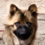
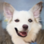
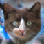

  <h1>NYCU Image and Video Generation</h1>
  

    Programming assignments for <b>Image and Video Generation (2026 Fall)</b> 
    National Yang Ming Chiao Tung University · Instructor: <b>Yu-Lun Liu</b>
  

<table>
<tr>
<td align="center" width="33%"><b>Lab 1 — DDPM</b></td>
<td align="center" width="33%"><b>Lab 2 — DDIM &amp; LoRA</b></td>
<td align="center" width="33%"><b>Lab 3 — Score Distillation</b></td>
</tr>
<tr>
<td align="center">
   
  
</td>
<td align="center">
  
</td>
<td align="center">
   
  
</td>
</tr>
<tr>
<td align="center"><i>AFHQ 64×64 samples, FID 8.29</i></td>
<td align="center"><i>DreamBooth + LoRA on one cat</i></td>
<td align="center"><i>SDI with Stable Diffusion 2.1</i></td>
</tr>
</table>

## Labs

| Lab | Topic | Highlights | Write-up |
| --- | --- | --- | --- |
| [Lab1-DDPM](Lab1-DDPM/) | DDPM from scratch | Swiss Roll toy model; AFHQ 64×64 with beta-schedule and prediction-target comparisons — best FID **8.29** (linear schedule, noise predictor) | [README](Lab1-DDPM/README.md) · [report](Lab1-DDPM/report/main.pdf) |
| [Lab2-DDIM-LoRA](Lab2-DDIM-LoRA/) | DDIM sampling, LoRA fine-tuning | DDIM on the Lab 1 checkpoint: FID **7.58** with 100 steps (vs. 8.29 for 1000-step DDPM); Naruto style LoRA and DreamBooth + LoRA on Stable Diffusion v1.4 | [README](Lab2-DDIM-LoRA/README.md) · [report](Lab2-DDIM-LoRA/report/main.pdf) |
| [Lab3-Distillation](Lab3-Distillation/) | Score distillation (SDS / VSD / SDI) | Optimizing a Stable Diffusion latent with a frozen model as critic — CLIP **0.307 / 0.298 / 0.301**; ablations on guidance, inversion steps and update interval | [README](Lab3-Distillation/README.md) · [report](Lab3-Distillation/report/main.pdf) |

Each lab folder contains the code (implemented parts marked in its README), a LaTeX report with the
compiled PDF, and instructions to reproduce the results. The assignment templates are provided by
the course TAs; datasets, checkpoints and generated outputs are not tracked.
